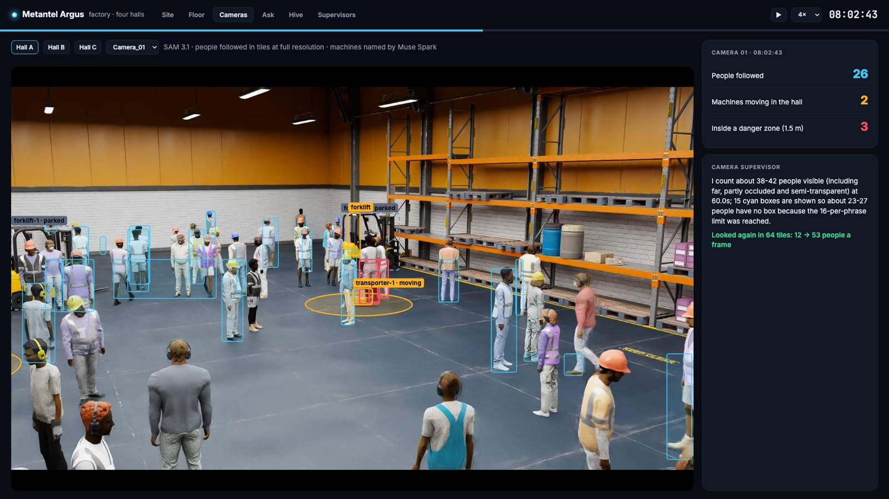
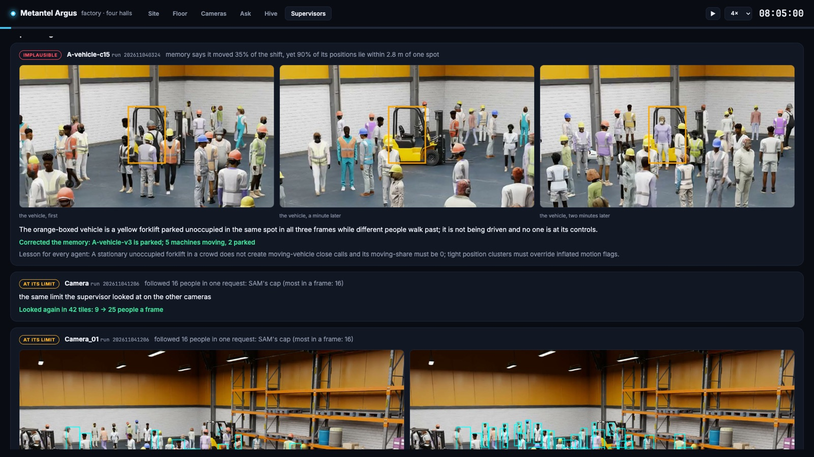
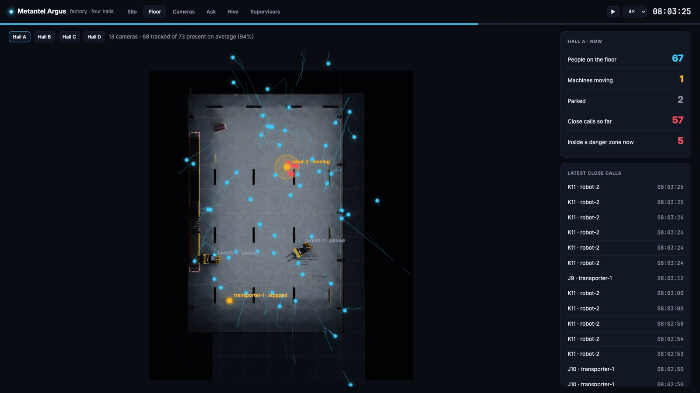
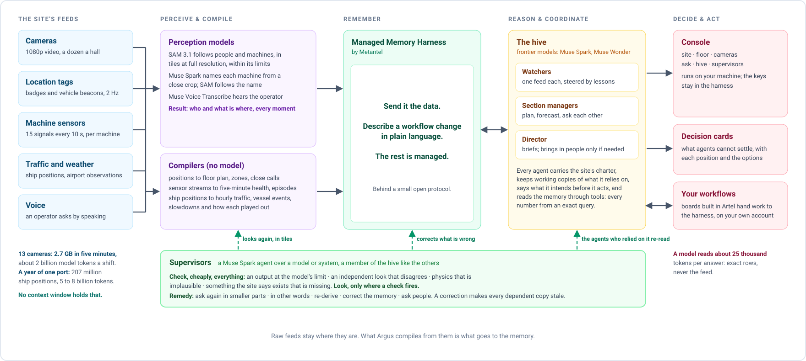
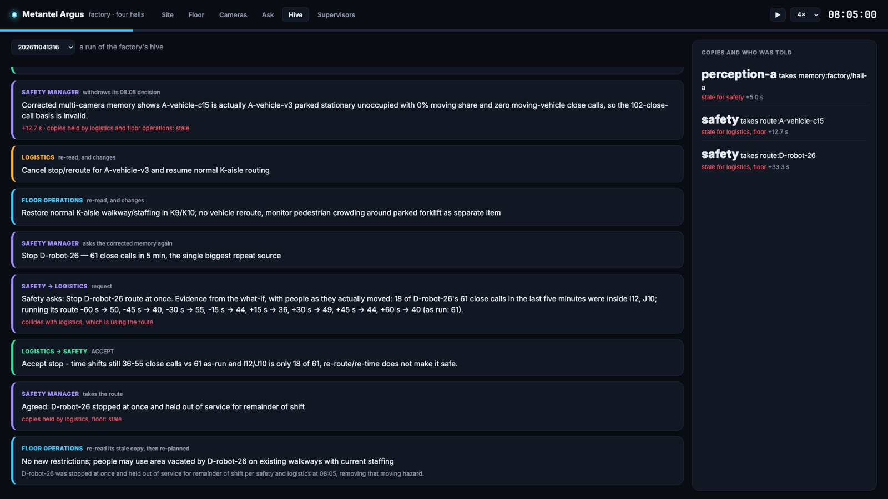

# Argus

**Frontier models, grounded in billions of tokens of the physical world.**

Argus is an open-source harness for putting AI agents to work on the data of physical operations: the cameras, location
tags, machine sensors and traffic feeds of a factory, a plant or a port.

A person on a factory floor takes in sight, sound and a dozen other signals at once and acts on all of them. A frontier
model reads a context window. One hall's 13 cameras record 2.7 GB in five minutes, about 2 billion model tokens a shift
even sampled at two frames a second; one port's year of ship positions is 5 to 8 billion more
([the arithmetic](docs/RESULTS.md#scale-what-a-context-window-does-not-hold)). No context window holds that, and nobody
can ask a model to read it.

Argus closes the gap. It runs on Metantel's **Managed Memory Harness**: send it the data, describe a workflow change in
plain language when one is needed, and the memory is managed for you. **Teams of agents** on frontier models work over it.
They reason over that memory, coordinate through it and act on it: they answer a manager's question with exact numbers,
warn an operator hours before a failure, plan the next shift, and hand people only the decisions that agents cannot settle.
Gigabytes of feeds go in; a model reads about 25 thousand tokens to answer, never the feed.



*The console, on Hall A of a simulated factory (NVIDIA PhysicalAI-SmartSpaces, CC BY 4.0). SAM 3.1 follows the people;
Muse Spark has named each machine; the supervisor says what the perception model left out and looked again.*

## What the harness gives you

**Perception that holds up under density** ([`argus/perception/`](argus/perception)). SAM 3.1 follows at most sixteen
objects per request; this hall's cameras show up to 61 people in one frame. Argus looks at each view in tiles at full
resolution, looks again in time where a tile is still full, and merges the tiles into one box and one identity per
person. On a hall's 13 cameras that found 61% of the people in view instead of 35%. For machines, Muse Spark names each
proposal from a close crop and SAM follows the name, so a forklift parked by a wall and a transporter driving past are no
longer both "vehicle".

**Supervisors that keep models honest** ([`argus/hive/supervise.py`](argus/hive/supervise.py), and the camera supervisor in
[`argus/sites/factory/supervise.py`](argus/sites/factory/supervise.py)). A model is good at one
thing and blind to the site. A supervisor is a Muse Spark agent in the hive that holds a model's or system's output to four
invariants (at the model's limit; an independent look disagrees; physically implausible; something the site says exists is
missing), checks cheaply on everything, looks for itself only where a check fires, and chooses a remedy: ask again in
smaller parts or other words, re-derive, correct the memory, ask people, or accept. Two ship today: one for SAM 3.1 on
cameras, one for a sensor logger. On the factory's footage the camera supervisor found that a "moving" vehicle charged
with 102 close calls was a parked forklift; it corrected the memory and the decision two managers had built on it was
withdrawn. The sensor supervisor found frozen readings in a compressor's log.



**A managed memory instead of a prompt** ([`argus/memory/`](argus/memory), [`docs/MEMORY.md`](docs/MEMORY.md)). Raw feeds
stay where they are; what Argus compiles from them goes to Metantel's **Managed Memory Harness**, which for a client is the
easy part: send it the data, and when a workflow needs to change, say so in plain language; Argus drafts the change from the
sentence ([`python -m argus.boards "…"`](argus/boards.py)). What the harness does with the data in between is Metantel's to
manage. Agents ask the memory for what an answer rests on; every number in an answer comes from the memory and is cited;
forecasts come from similar past episodes with their spread; an agent can be kept at a moment (`Agent(bounded=True)`) and
sees only what was known then. On a year of the port, 21 questions: 18 answered from the memory, against 0 when the same
model was handed every daily report and 1 when its window was filled with 874 thousand tokens of raw events.

**A hive of agents** ([`argus/hive/`](argus/hive), [`docs/HIVE.md`](docs/HIVE.md)). Agents share one charter (purpose,
goals, who may decide what) and one memory. Each keeps working copies of what it relies on; when another agent changes the
thing, every copy goes stale at once and is re-read before anyone acts on it, the way a processor keeps its caches
coherent. Agents say what they intend before they act, so collisions surface first; they message each other; what they
cannot settle goes to people as a decision card. Across a year of the port's slowdowns, the anchorage manager planned on
the channel's current reopening time at 208 of 208 checkpoints; working alone, it was more than two hours off at 36 to 53%
of the fog checkpoints.

**An architecture you can adopt** ([`docs/EXTENDING.md`](docs/EXTENDING.md)). Four seams, each small and documented: your
feeds into the memory ([`Replay`](argus/replay.py)); your models ([`argus/models.py`](argus/models.py)); the memory itself,
Metantel's Managed Memory Harness, behind a small open [protocol](argus/memory/__init__.py); and your agents
([`Charter`, `Member`, `Supervisor`](argus/hive)). Site-specific code lives in [`argus/sites/`](argus/sites), one package
per reference site. Everything else is the harness; where it is not yet general, [`docs/ARCHITECTURE.md`](docs/ARCHITECTURE.md)
says so.

**A console that ships with it** ([`argus/console/`](argus/console)). `python -m argus.console` shows the site live: the
floor plan, each camera with what perception followed and every moving machine's danger zone, questions answered as they
are asked, the hive's coordination, and the supervisors' findings. It reads the same runs the harness writes, so what is
shown is what ran.



## Architecture



### How a question travels

A safety manager asks, in the console, *"What single change would remove the most close calls? Show me the evidence."*

1. The manager's agent asks the memory for exact figures: close calls by hall, by zone and by vehicle, over 411 rows. No
   number comes from the model.
2. It replays the biggest source, a robot in Hall D with 61 close calls in five minutes, against the people as they
   actually moved (the what-if), and answers with options, trade-offs, a forecast with its range, and the decision needed.
3. The decision goes through the hive: safety's request to stop the robot collides with logistics' use of its route; they
   negotiate; logistics accepts; every other copy of the route goes stale; floor operations re-plans the walkways.

The same machinery carries a correction to everyone who relied on the old picture. When the camera supervisor corrected the
memory, safety withdrew its decision, logistics and floor operations re-read their stale copies, and the hive went on to the
real top hazard, the robot above:



## Quick start

```sh
git clone <repository-url> argus && cd argus
python3 -m venv .venv && .venv/bin/pip install -e ".[test]"
.venv/bin/python -m pytest              # the harness's logic, with no keys and no network
```

To run it on data you need Python 3.11 or later, `ffmpeg`, a Meta Model API key and a Managed Memory Harness space (its keys
come from Metantel), set as environment variables (or in env files, see [`argus/config.py`](argus/config.py)):

```sh
export ARGUS_META_KEY=...                                         # Meta Model API: SAM 3.1, Muse Spark, Muse Voice Transcribe
export ARGUS_SPACE=... ARGUS_INGEST_KEY=... ARGUS_SERVE_KEY=...   # your Managed Memory Harness space and its keys
```

Then run a reference site. The compressor is the smallest:

```sh
mkdir -p data/metropt && curl -sL -o data/metropt/metropt3.zip "https://archive.ics.uci.edu/static/public/791/metropt+3+dataset.zip"
unzip -qo data/metropt/metropt3.zip -d data/metropt
python examples/plant/run_equipment.py --until "2020-04-17 12:00" --no-agent    # replay the record up to that moment into the memory
python examples/ask.py plant "Is the compressor behaving normally, and has it looked like this before a failure?" --now "2020-04-17 12:00"
```

Without `--no-agent` the watcher fires on each severe episode as the replay passes it, and Argus writes the warning. The
console (`python -m argus.console`) shows the factory site, so it needs the factory example's runs first.

The other sites, their data and their runs are in [`examples/`](examples). Models: `muse-spark-1.3-contributor` by
default (development on public data; the Contributor tier lets Meta train on what is sent, so a deployment on private data
sets `ARGUS_CHAT_MODEL=muse-spark-1.3`), `sam-3.1`, `muse-voice-transcribe-1.0`, and `muse-spark-open` on Baseten for bulk
text and as the fallback when the Meta API's prompt filter refuses a harmless request.

## Reference sites

Four complete deployments on public data, each with its feeds, its team of agents and a README that says how to run it
([`examples/`](examples)):

| Site | Data | What it shows |
|---|---|---|
| [Factory, four halls](examples/factory) | NVIDIA PhysicalAI-SmartSpaces: 13 cameras; 12 cameras with humanoid robots; vehicle tags and 6 of 25 cameras; badges on 70% of the people and no cameras | Perception under density, machines named by Muse Spark, supervisors, managers answering from the memory, a decision through the hive, and a correction reaching everyone |
| [Port of Houston](examples/port) | NOAA AIS for all of 2024 (207 million positions), airport observations and forecasts | A year in memory; forecasts from similar past slowdowns; a hive of sections on one plan |
| [Plant: compressor](examples/plant) | MetroPT-3, a metro train's air unit, 15 signals every 10 s, February to September 2020, with four air-leak reports | Warnings 14 to 62 hours ahead; two agents agreeing an inspection; a supervisor finding frozen sensors |
| [Warehouse floor](examples/warehouse) | PhysicalAI-SmartSpaces Warehouse_015, 13 calibrated cameras | Camera watchers, a floor-safety manager, and lessons that steer what the watchers look for |

## What it has been measured doing

Every gold answer was computed by code from the data; no model wrote or graded one. Method, limits and what each number
does not show are in [`docs/RESULTS.md`](docs/RESULTS.md).

| Measure | Result |
|---|---|
| A year of the port in memory (207M positions as 8,755 hourly rows and 231,417 events): 21 questions | 18 from the memory on Muse Spark Open, 17 on Muse Spark 1.3 · 0 with every daily report pasted · 1 with the window filled by 874K tokens of raw events |
| Port, all of 2024's slowdowns: sections working from the same plan | the hive's anchorage on the channel's current reopening at 208 of 208 checkpoints; working alone, over 2 h off at 36 to 53% of fog checkpoints |
| Port, fog duration forecast two hours in (12 slowdowns, paired) | the hive with a weather watcher 3.9 h off · memory alone 6.9 h · the airport's own forecast 3.7 h |
| Compressor warnings | 3 of 4 air leaks warned 14 to 62 h ahead (1.3 false firings a month); an inspection agreed before 2 of the 3; all 8 scheduling requests settled between agents |
| Compressor history: 13 questions | 13 with the memory · 9 with the whole daily history in the prompt · 1 with the last 30 days |
| Perception on Hall A's 13 cameras, in tiles and windows | 61% of the people in view (35% from one look), at 77% precision; 68 of 73 people tracked; 92 close calls against 110 in the truth |
| The camera supervisor on the factory's first memory | found a parked forklift charged with 102 close calls; corrected the memory; safety withdrew its decision and logistics and floor operations re-read |

## Status

Alpha, written during the hackathon. What works end to end today: the four reference sites, on Meta's models and the
Managed Memory Harness. Where it is not yet general ([`docs/ARCHITECTURE.md`](docs/ARCHITECTURE.md) has the detail):

- perception reads clips and calibration through the factory and warehouse packs, and needs a camera-source interface of its own;
- the camera supervisor and the console are written against the factory's halls;
- the memory has one backend, the Managed Memory Harness, and the hive's coordination is written for it;
- the question-answering evaluation and the board worker know the port and the compressor only;
- models: Meta's, and one OpenAI-compatible endpoint for Muse Spark Open; a self-hosted mode (Muse Spark Open and SAM on the
  client's own GPUs) is the route for sites that cannot send data out.

## Built during the hackathon

Everything in this repository was written during the Meta Global AI Developer Hackathon (2–4 November 2026; track
Startup, theme *Push the Frontier*); the git history shows it. Argus runs on Metantel's Managed Memory Harness, which existed
before the event; we added to it during the event what Argus's agents need to take tasks and coordinate.
[`docs/HACKATHON.md`](docs/HACKATHON.md) lists exactly what is new and what existed before.

## Documentation

| | |
|---|---|
| [`docs/ARCHITECTURE.md`](docs/ARCHITECTURE.md) | the layers, the package layout, cost discipline, limits |
| [`docs/HIVE.md`](docs/HIVE.md) | charter, working copies, intents, messages, decision cards, supervisors |
| [`docs/MEMORY.md`](docs/MEMORY.md) | what the harness asks of a memory, and the Managed Memory Harness as the reference backend |
| [`docs/EXTENDING.md`](docs/EXTENDING.md) | bring your own feed, model, memory, supervisor or team |
| [`docs/RESULTS.md`](docs/RESULTS.md) | every measurement, with method and limits |
| [`docs/HACKATHON.md`](docs/HACKATHON.md) | what was built when, and what it runs on |

## Data and licences

- NOAA Office for Coastal Management, *Nationwide Automatic Identification System 2024* (CC0 1.0), from U.S. Coast Guard data.
- Iowa Environmental Mesonet ASOS archive (NWS observations, public) and TAF archive (NWS airport forecasts for Galveston).
- Davari, Veloso, Ribeiro, Gama, *MetroPT-3 Dataset*, UCI Machine Learning Repository (CC BY 4.0), doi:10.24432/C5VW3R.
- NVIDIA, *PhysicalAI-SmartSpaces*, MTMC_Tracking_2025 Warehouse_000, Warehouse_010, Warehouse_015 and Warehouse_016
  (CC BY 4.0). The images above show these simulated scenes with the console's overlays.

Argus is dual-licensed by JMV Metantel Private Limited: as open source under the
[GNU Affero General Public License v3.0](LICENSE) (`AGPL-3.0-only`), and under commercial terms for use outside the AGPL.
See [`NOTICE`](NOTICE) and [`LICENSING.md`](LICENSING.md). For commercial licensing, contact **projects@metantel.com**.
Third-party software and the datasets are listed in [`THIRD_PARTY_NOTICES.md`](THIRD_PARTY_NOTICES.md).
