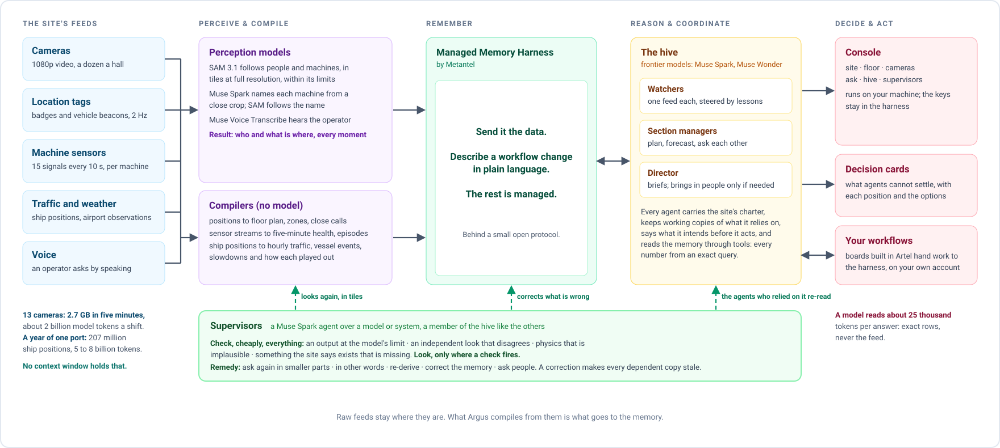

# Argus architecture

## The idea

A site produces far more signal than any model can hold. One hall's 13 cameras record 2.7 GB in five minutes (about two
billion model tokens a shift, sampled at two frames a second and read as images); one machine's sensors write 8,640
readings a day; one bay of a port reports 560,000 ship positions a day. A person standing in the site takes all of that in
through eyes and ears and judges it against years of experience. A frontier model has a context window.

Argus puts the data where a model can use it. Perception models and compilers turn the feeds into a small, exact
**memory**, Metantel's Managed Memory Harness (send it the data; describe workflow changes in plain language); **agents** on frontier models reason over the memory with tools, coordinate
through it, and act on it; people see everything and decide what the agents cannot settle. Raw data stays where it is. Only
compiled rows, short notes, facts and a few images enter the memory, so a model reads about 25 thousand tokens to answer
instead of billions.



## The layers

| Layer | Module | What it does | Models |
|---|---|---|---|
| Models | [`argus/models.py`](../argus/models.py) | Meta's models through the Meta Model API (Muse Spark, Muse Wonder, SAM 3.1, Muse Voice Transcribe) and Muse Spark Open through any OpenAI-compatible endpoint (Baseten is wired); every call metered in a ledger at list prices | |
| Perception | [`argus/perception/`](../argus/perception) | `floor.py`: camera video to positions on the floor plan through each camera's calibration, and close approaches. `tiles.py`: SAM in tiles at full resolution, split again in space and then in time where a tile is full; one box and one identity per person across tiles. `naming.py`: Muse Spark names each machine SAM proposes from a close crop; SAM follows the names | SAM 3.1, Muse Spark |
| Compilers | [`argus/sites/*/feed.py`](../argus/sites) | Deterministic: ship positions to hourly traffic, vessel events and slowdowns; 10-second sensor signals to five-minute health and abnormal episodes; floor positions to zone occupancy, vehicle tracks and close calls | none |
| Memory | [`argus/memory/`](../argus/memory) | The protocols the harness is written against (`Memory`, `Coordination`), and `metantel.py`, the client of the Managed Memory Harness. The hive's coordination (presence, intents, claims, messages, decision cards, facts) is `hive/link.py`, its implementation of `Coordination` | |
| Replay | [`argus/replay.py`](../argus/replay.py) | Feeds the memory in time order: rows up to T exist before anything happens at T, so whatever is asked at T sees the past and nothing after | |
| Reasoning | [`argus/agent.py`](../argus/agent.py) | The loop: the memory as tools (search, exact queries), similar past episodes, the hive's facts, and tools the site adds (a what-if over recorded tracks); answers as JSON (level, headline, body, actions, forecasts, confidence, citations) for an audience | Muse Spark, Muse Wonder |
| Hive | [`argus/hive/`](../argus/hive) | `mind.py`: the charter and the member with working copies. `link.py`: presence, intents, claims, messages, decision cards, facts. `manager.py`: a member whose thinking is the reasoning agent. See [`HIVE.md`](HIVE.md) | Muse Spark Open, Muse Spark |
| Supervisors | [`argus/hive/supervise.py`](../argus/hive/supervise.py) | Four invariants an output is held to (`at_limit`, `disagrees`, `implausible`, `missing`), the supervisor's own look where one fires, the remedies (split, reprompt, rederive, correct, ask people, or accept), corrections that make dependent copies stale. Two ship: the camera supervisor (SAM 3.1; [`sites/factory/supervise.py`](../argus/sites/factory/supervise.py)) and the sensor supervisor (a logger) | Muse Spark |
| Console | [`argus/console/`](../argus/console) | A stdlib web server and a canvas front end: site, floor, cameras, ask, hive, supervisors. Every view draws itself for a moment of the shift | Muse Spark (for questions asked there) |
| Boards | [`argus/boards.py`](../argus/boards.py), [`argus/worker.py`](../argus/worker.py) | Boards built in Artel end in an agent part; the worker collects the task, answers on your own model account and puts the answer back, where Artel shows it under the board | Muse Spark |
| Evaluation | [`argus/eval/`](../argus/eval) | Questions with answers computed by code, asked with the memory, with a window of recent reports, with the whole history in context, and with nothing | Muse Spark |

## The package

```
argus/
  models.py  config.py  agent.py  replay.py  boards.py  worker.py
  memory/        __init__.py (Memory, Coordination)   metantel.py (the Managed Memory Harness client)
  perception/    floor.py   tiles.py   naming.py
  hive/          mind.py   link.py   manager.py   supervise.py
  sites/         one package per reference site: feed.py (raw data into compact tables), pack.py (where the memory
                 holds documents: what goes in) and team.py (its agents); the warehouse's feed is perception/floor.py
    factory/  port/  plant/  warehouse/
  console/       server.py   static/
  eval/          qa.py   year.py
examples/        how to run each site: download, replay, hive, evaluation
```

The harness is everything outside `sites/`. A new site is a new package under `sites/` and a folder under `examples/`; see
[`EXTENDING.md`](EXTENDING.md).

## Forecasts come from memory, not from the model

When a watcher fires (a slowdown two hours in, a compressor episode one hour in), Argus knows only the episode so far.
`Episodes.similar()` reads the site's episode table from the memory, keeps the episodes that had ended before now, ranks them
by distance on the features known so far, and returns the five nearest with the spread of their outcomes (median, range,
rate). The model reads that spread and explains it; it does not invent the number.

Episode rows are appended only when their outcome is known (a slowdown once its queue has recovered or a day has passed; a
compressor episode 72 hours later, or when a failure began within those 72 hours), so no forecast can see its own answer.

## A whole year in memory, every agent kept at its moment

The port's memory holds all of 2024 at once (207M positions compiled to 8,755 hourly rows, 231,417 vessel events, 4,737
ships, 135 slowdowns, 366 daily reports). An agent asked at a moment must not see past it, so its tools keep it there
(`Agent(bounded=True)`): every query's window ends at that moment, an episode counts only once its outcome was known
(`known_at`), and documents and facts dated later are invisible to it.

## Supervisors, in one paragraph

A model is good at one thing and blind to the site: SAM follows sixteen objects a request and cannot tell a forklift being
driven from one parked while people walk past; a sensor logger can freeze on one value for hours while the machine runs. A
supervisor is a hive member whose section is one model or system. It holds that system's output to four invariants (at its
limit; an independent look disagrees; physically implausible; missing what the site says exists), looks for itself, with the
site's charter and the evidence, only where a check fires, and chooses a remedy. A correction claims the memory it changes,
so every agent holding a copy is told it is stale. Two supervisors ship (cameras, a sensor logger); the camera supervisor
runs `at_limit` and `implausible`, the factory example adds `missing`, the sensor supervisor runs `implausible`, and
`disagrees` is written and tested but not yet called by a shipped supervisor. [`HIVE.md`](HIVE.md#supervisors) has the detail.

## Boards hand work to the harness

A board built in Artel (a table, a check, an agent part: *warn, for the operator*) leaves a task in the Managed Memory
Harness. The harness ([`argus/worker.py`](../argus/worker.py)) collects it, answers it with the reasoning agent on the client's
own model account, and puts the answer back, where Artel shows it under the board.

The memory never calls out: the harness pulls, so it can run behind any firewall and on any model account.

## Cost discipline

- Raw data stays local. Only compiled rows, short notes and a few images enter the memory.
- SAM is billed per frame, so clips are cut to 2 fps and 960×540 before upload (600 frames per 5-minute camera); tiles are cut
  from the full-resolution video only where a view is crowded.
- Watchers and compilers are deterministic; a model runs only when one fires, when a supervisor's check flags something, when
  a board hands over a task, or when someone asks.
- Development runs on Muse Spark 1.3 Contributor ($0.10 in / $0.20 out per million tokens) on public data. The Contributor
  tier lets Meta train on what is sent; a deployment on private data sets `ARGUS_CHAT_MODEL=muse-spark-1.3`.
- Every model call is metered into a ledger with list prices; each run reports what it spent.

## Where the harness is not yet general

Stated so that nobody has to find it out:

- **Perception reads its clips through the site packs.** `tiles.py` and `naming.py` ask `sites/factory/feed.py` for a camera's
  clip and its cached detections, and `floor.py` holds the Warehouse_015 scene as its default (`SCENE`, `CLIPS`). They need a
  small camera-source interface (a clip, its calibration, a cache) so a new site brings its own cameras without touching the
  factory.
- **The camera supervisor is written against the factory's halls.** It lives in the factory pack
  ([`sites/factory/supervise.py`](../argus/sites/factory/supervise.py)); the base class, the four invariants, the remedies and
  the sensor supervisor are in `hive/supervise.py`, which imports nothing from `sites/` (a test holds that).
- **The console shows the factory site.** Its views are written against the factory's halls and need the factory example's
  runs; taking any site pack is the next step.
- **The memory has one backend**, the Managed Memory Harness. `Agent` and `Replay` take the `Memory` protocol, but the hive's
  coordination (`Link`) is written for it, so another backend brings its own `Coordination`.
- **The evaluation and the board worker know two sites.** `eval/qa.py` and the `SITES` registry in `worker.py` cover the port
  and the compressor only.
- **Models:** Meta's models through the Meta Model API, and one OpenAI-compatible endpoint (Baseten's, set by environment
  variables) for Muse Spark Open. A third provider is an adapter in `models.py`, not a configuration. A self-hosted mode (Muse
  Spark Open and SAM on the client's GPUs) is the route for sites that cannot send data out.

## What is deliberately not here

- No integration with a client's control systems. An agent's answer says what to do and who should do it; acting on it is the
  client's integration to build, behind their own approvals.
- No fine-tuning or training. Every model is used as served.
